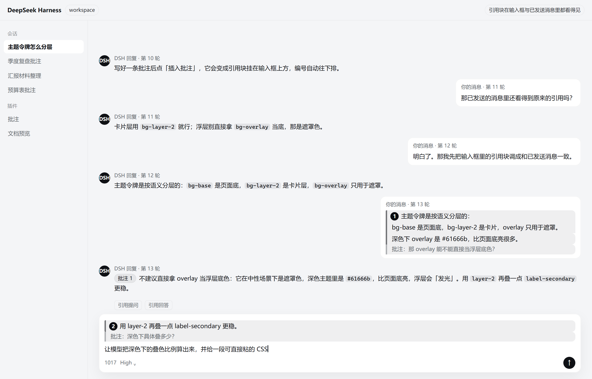
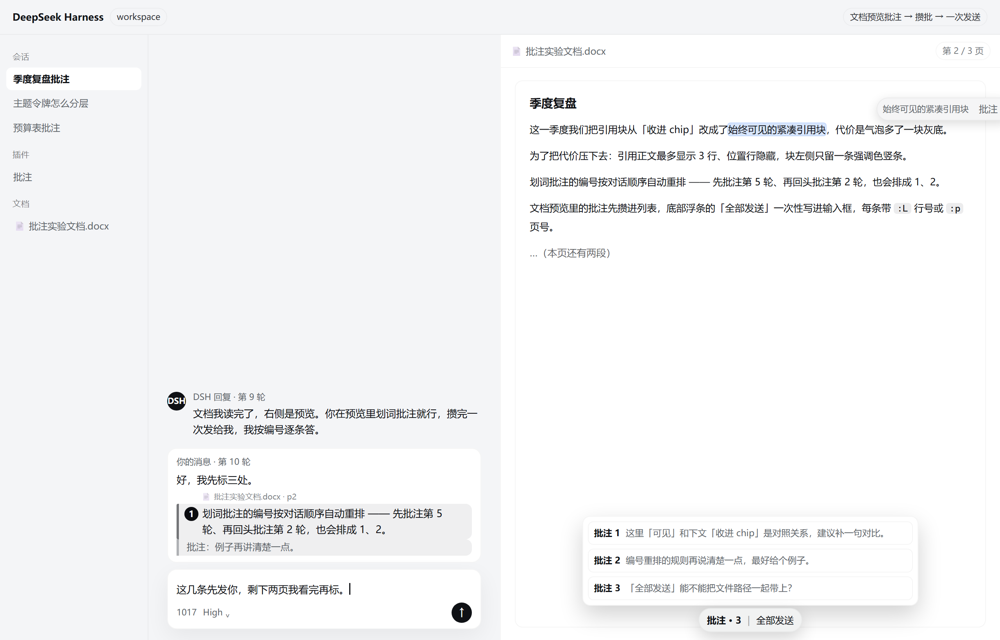
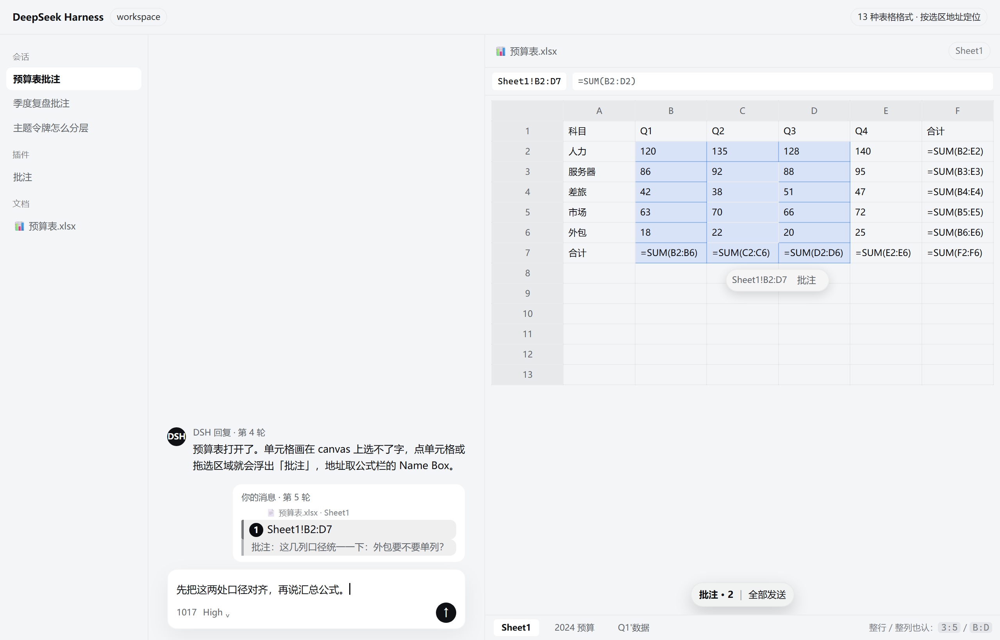
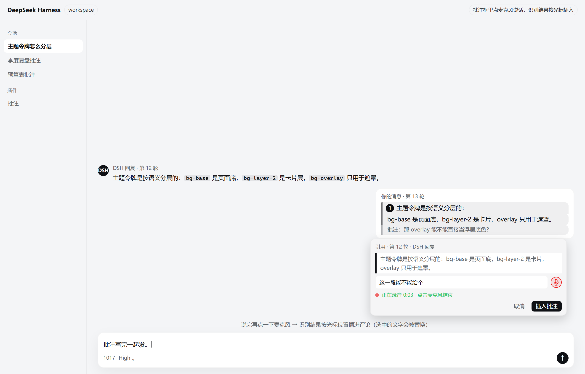
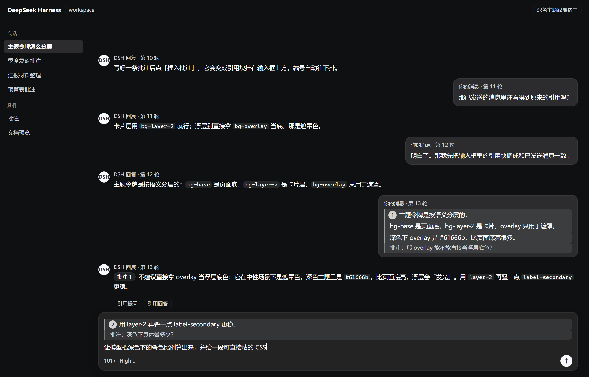

# dsh-quote-annotate-pro

[](https://www.npmjs.com/package/dsh-quote-annotate-pro)
[](https://github.com/zhao-guang-ai/dsh-quote-annotate-pro/actions/workflows/ci.yml)
[](./LICENSE)
[](https://hub.xerj.org/contributors/zhao-guang-ai)



**Select → annotate → quote. After you send, the quote is still visible — and one click takes you back to the source.**

Whether you select text in a chat message or in a document preview in the right sidebar, annotations have one job: **the quote never disappears, the origin is never lost, and you can always get back.**

- **Annotate chats**: select text → 「批注」 bubble → write a comment → a **compact quote block with a round number** lands in the composer and stays visible after sending. Multiple annotations are numbered top-to-bottom in conversation order and renumber themselves automatically.
- **Per-annotation replies**: the model answers `Annotation 1:`, `Annotation 2:` … and each `Annotation N:` in the reply becomes a `批注 N` chip — hover for the quote and comment, click to jump back to the source.
- **Annotate document previews**: select text in docx / PDF / Markdown / code previews → notes collect in a **file notes list** → the `批注 · N` bar at the bottom sends them all in one go; each block carries the file and line/page and reopens the source where it came from.
- **Annotate Excel ranges**: cells are painted on a canvas, so there is no selectable text — notes are located by the formula bar's **range address** (`Sheet1!B2:D7`, whole row `3:5`, whole column `B:D`), for 13 spreadsheet formats (`xlsx / xlsm / xlsb / ods / numbers / csv / tsv` …).
- **Dictate notes**: the microphone at the right of the annotation input records once, transcribes through the host's voice-input plugin, and inserts the text at the caret.
- **Client-only and offline**: anchors and notes live in your local `localStorage` — no network requests; dark theme follows the host.

| | |
|---|---|
| <br>Select in a document preview → collect notes → send once | <br>Excel notes are located by range address; cell contents are never read |
| <br>Tap the microphone in the annotation box and speak | <br>The same quote blocks and numbers in the dark theme |

> ⭐ **If this plugin helped you, a Star is the most direct way to support it** → [zhao-guang-ai/dsh-quote-annotate-pro](https://github.com/zhao-guang-ai/dsh-quote-annotate-pro) (it also helps other DSH users find it).
>
> Listed in the in-DSH market (`dshmarket`), [DSH Market](https://dsh.market/?q=zhao-guang-ai%2Fdsh-quote-annotate-pro), [dsh-plugin.org](https://dsh-plugin.org/zh/plugins/zhao-guang-ai/dsh-quote-annotate-pro), dsh.pub, dsh-xray, HackSing/dsh-plugins, and [awesome-deepseek-harness](https://github.com/0xsline/awesome-deepseek-harness).

## The design choice: keep the quote *visible* instead of folding it into a chip

Most selection-quote/annotation plugins **hide the quote**: the bubble keeps only a `引用1` chip or a "批注 ×N" tag, and you open or hover it to see the text. This plugin takes the other road:

| | Fold into a chip / tag (common) | **This plugin: compact quote block** |
|---|---|---|
| Sent bubble | Just a chip/tag — you can't see what was quoted | **Shows the quoted snippet** (max 3 lines, truncated) |
| Comparing with the source | Hover or expand the tag | **Click the block → jump back + highlight** |
| Composer | Short chip label | Same quoted snippet as in the message |
| Model side | Implementation-dependent | Text still starts with `【引用 · 第N轮 · 角色】` — position preserved |
| Cost | Cleaner bubbles | One grey quote area (hence 3 lines + hidden turn/role line) |

In one sentence: **a quote is part of the conversation and should not be hidden.** If you prefer absolutely clean bubbles with quotes only on hover, other plugins do that better; if you keep asking "which sentence did I quote here?", that is why this plugin exists.

## Quick start

1. **Select text** in any message → a bubble appears above the selection → click 「批注」 → write a comment (optional) → `Enter`.
2. A **compact quote block** lands in the composer (quoted snippet + `批注：comment`, position line hidden); click it to jump back to the source.
3. After sending, the bubble keeps the compact quote block — click it any time to return to the source and highlight it. Each finished turn also gets 「引用提问 / 引用回答」 to quote the whole turn.

## Features

| Capability | Detail |
| --- | --- |
| Select & annotate | Select text in the transcript → a bubble appears above the selection → write a comment (optional) → `Enter` |
| **Automatic numbering** | Multiple annotations in one message are numbered (`批注 1`, `批注 2`, …; deleting one never reuses a number); the composer shows `批注：N`, the model sees `【批注 N · 第5轮 · 角色】` |
| **Quote block (in the composer)** | Inserting writes plain text that the plugin folds into a compact quote block identical to the sent one; click it to jump back to the source — no chip involved |
| **Compact quotes in the transcript** | A sent message shows only a **compact quote block** (up to 3 lines) followed by `批注：…`. The message text still starts with the position line — hidden in the UI, so the model keeps the position context |
| **Per-annotation replies** | The protocol instruction is embedded in the first position line (hidden in the UI); `Annotation N:` in the model's reply renders as a `批注 N` chip — hover for the quoted text + comment, click to jump back to the source |
| **Turn-accurate context** | The quote block starts with `【批注 2 · 第3轮 · 你的消息】` followed by the quoted text and your comment, so the model knows exactly which annotation, which turn and whose message |
| Turn-level quoting | Every finished turn gets `引用提问` / `引用回答` buttons that quote the whole question or answer |
| Anchors survive reload | The `ref → anchor` map is persisted in `localStorage` (per session, 60 entries max), so quotes still jump after a page refresh |

> An enhanced fork of [`dsh-quote-annotate`](https://github.com/wangwei-wade/dsh-quote-annotate) (MIT, by wangwei-wade).
> Upstream v0.1.1 **fails silently** on **DSH 0.2.0-rc.2** (loads without error, registers no UI at all). This fork fixes 4 compatibility
> problems, adapts 2 further interface changes, and adds 3 capabilities. Still MIT — see [LICENSE](./LICENSE).
> Full write-up: [SUMMARY.md](./SUMMARY.md) (Chinese).

## Install

```sh
# from npm (recommended)
dsh plugin --profile <profile> add dsh-quote-annotate-pro

# from GitHub
dsh plugin --profile <profile> add github:zhao-guang-ai/dsh-quote-annotate-pro

# from a local clone (link install: edits apply instantly via HMR)
dsh plugin --profile <profile> add <absolute path to this repo>
```

Verified on **DSH 0.2.0-rc.2**, desktop profile (Windows). A page reload (or an automatic client-HMR reload) is needed after installation.

## How it works

```
select text
  │ bubble 「批注」→ editor → Enter
  ▼
input.setDraft(...)  writes plain text: 【批注 N · 第N轮 · 角色】 + quote + 「批注：comment」
  │ the composer decorator folds it into a compact quote block right away
  ▼
composer shows: compact quote block + 批注：comment (click the block to jump back)
  │ send (message text = composer text, position line included)
  ▼
model sees: which annotation, which turn, whose message, quote, comment
  │ reply contains Annotation 1: … → rendered as a 批注 1 chip
  ▼
hover the chip for quote + comment, click to jump back to the source

On the UI side the plugin wraps the turn/role line and the quoted text at render time:
the line is hidden, the text becomes a compact block, and clicking the block scrolls
back to the anchor and highlights it (no visible affordance). The composer and the
sent messages share exactly the same visual rules.
```

Official surfaces used: `slots` (`shell.overlay`, `conversation.chat.turnTail`),
`conversation.input` (draft), `sessions.binding` / `sessions.scope`, and the DOM anchors
`data-chat-anchor-key` / `data-chat-turn` / `data-chat-flow-kind`.

## Differences from upstream

**Compatibility fixes** (without these the plugin does nothing, silently):

1. Missing `inject: ['slots']` — `apply()` returned early before the service was ready; now declares the dependency and reports each registration step.
2. `conversation.chat.turnTail` became a **list** slot (was `chain`); the old `{ select, priority }` registration threw and aborted the 4 registrations after it.
3. `input.insertReference(...)` no longer exists — quoting fell back to plain text; now uses the `slash/input-insert-reference` session event.
4. `useSessions(s => s.current)` is always `undefined` in this version (the session-list snapshot has no `current` field) — clicking 「批注」 only closed the bubble. Now the session id comes from a session-scoped slot probe.

**Interface adaptations:** the turn-tail buttons read text from the **Chat snapshot** (`useChat`, `nodes` is a `Map`, identity is `anchorSeq`, assistant kind is `assistant-step`); the composer quote block is plain text decorated by the plugin (no chip / occurrence dependency), which keeps the composer and the sent bubble visually identical.

## Development

```sh
npm run check    # manifest self-check (package.json / patch / bundle registration id)
npm test         # pure-function self-check for the client bundle (numbering, block parsing, snippets — no browser/network)
npm run diag     # local diagnostics sink (http://127.0.0.1:47821)
```

`lib/client.js` is a hand-written bundle (no build step) — edit and save; the client HMR reloads it. See [README.md](./README.md) (Chinese) for the diagnostics channel and known limitations.

### Privacy / network (state this accurately in directory entries)

This is a client-side plugin: **no external services, no credentials**. Its only data store is the anchor map in `localStorage` (≤60 entries per session).

⚠️ It **does** send one probe to `http://127.0.0.1:47821` on load by default (`DIAG_ENABLED = true`) plus diagnostics once a local sink answers — so **do not describe it as "no network access"**. On 2026-10-16 the `0xsline/awesome-deepseek-harness` maintainer corrected exactly that claim while merging our entry to *"the client enables localhost diagnostic requests by default"*. Set `DIAG_ENABLED = false` if you want zero requests to be literally true.

## Releasing (maintainers)

Releases go through **npm Trusted Publishing (OIDC)** — no token is stored in the repository and no one-time code is needed:

1. Bump `version` in `package.json` and note the change in `CHANGELOG.md`
2. Commit, tag and push:

   ```sh
   git tag -a v0.2.2 -m "v0.2.2"
   git push origin main --follow-tags
   ```

3. [`release.yml`](.github/workflows/release.yml) then checks the tag against the version, runs the syntax/manifest checks, and publishes with `--provenance` (SLSA attestation). An already-published version is skipped, so the workflow is safe to re-run.

Trusted Publisher configured on npm: `zhao-guang-ai` / `dsh-quote-annotate-pro` / workflow `release.yml` / environment `npm`.

## License

MIT — see [LICENSE](./LICENSE). Upstream: [`wangwei-wade/dsh-quote-annotate`](https://github.com/wangwei-wade/dsh-quote-annotate) (MIT, © 2026 wangwei-wade).
